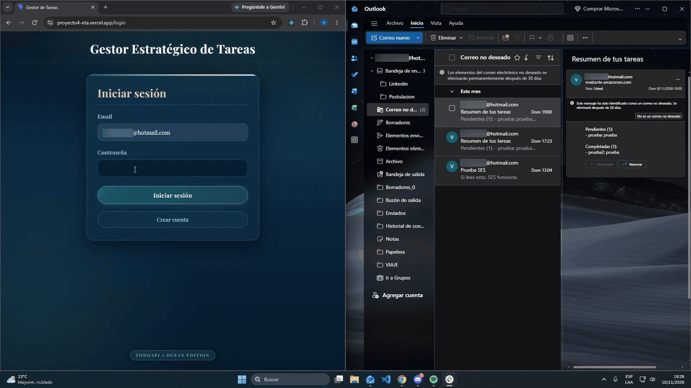

# Gestor Estratégico de Tareas

Aplicación web de una sola página (SPA) desarrollada para **MateCode** como Proyecto Integrador 4 de SoyHenry. Cada persona se registra, inicia sesión y administra únicamente sus propias tareas, con sincronización en tiempo real y un resumen enviado por email.

**Demo:** https://proyecto4-eta.vercel.app

> El envío del resumen por email tiene una limitación en la demo: ver [Limitaciones conocidas](#limitaciones-conocidas).

## Demostración del resumen por email



## Funcionalidades

- Registro, inicio y cierre de sesión con email y contraseña.
- Rutas protegidas: sin sesión, la app redirige al login.
- **Inicio (`/`)**: total de tareas, pendientes, terminadas y formulario para crear una tarea.
- **Mis tareas (`/tasks`)**: pendientes y finalizadas en bloques separados, con 3 tareas por página en cada uno.
- Crear, editar, completar, volver a pendiente y borrar tareas.
- Sincronización en tiempo real entre pestañas y dispositivos.
- Cada usuario ve solo sus tareas, garantizado por las reglas de seguridad de Firestore.
- Botón para enviar por email un resumen de las tareas.
- Diseño adaptable a celulares.

## Stack

| Área | Tecnología |
| --- | --- |
| Frontend | React 19, TypeScript, Vite, React Router, CSS |
| Autenticación | Firebase Authentication |
| Base de datos | Cloud Firestore |
| Backend | Vercel Functions, Firebase Admin SDK |
| Email | AWS SES |
| Tests | Vitest, React Testing Library, jsdom |
| Deploy | Vercel, GitHub |

## Estructura

```text
api/
  send-summary.ts        Función de Vercel que envía el resumen por email
src/
  components/            Componentes reutilizables (FormField)
  features/
    auth/                Contexto de sesión, hook useAuth y encabezado de sesión
    tasks/               Componentes, hooks, validaciones, contadores y paginación
  pages/                 Home, Login, Register y Tasks, con sus estilos
  routes/                Rutas, ProtectedRoute y PublicRoute
  services/firebase/     Único lugar del frontend que usa el SDK de Firebase
  types/                 Tipos compartidos
  utils/                 Validaciones y mensajes de error de autenticación
tests/                   Tests con Vitest y React Testing Library
firestore.rules          Copia de las reglas publicadas en Firestore
vercel.json              Rewrite para que funcionen las rutas de la SPA
```

La consigna sugiere una carpeta `functions/`, pero la función está en `api/` porque es la carpeta que Vercel usa para detectar sus Functions.

## Instalación local

Requisitos: Node.js 24 y npm.

```bash
git clone https://github.com/Peepzis/ProyectoM4.git
cd ProyectoM4
npm install
cp .env.example .env
```

Completá `.env` con los datos de tu proyecto de Firebase y levantá la app:

```bash
npm run dev
```

Publicá también el contenido de `firestore.rules` en la consola de Firebase.

## Variables de entorno

Los nombres están en [`.env.example`](.env.example). Nunca subas valores reales al repositorio.

| Variable | Uso | Dónde se usa |
| --- | --- | --- |
| `VITE_FIREBASE_API_KEY` | Configuración web de Firebase | Navegador |
| `VITE_FIREBASE_AUTH_DOMAIN` | Configuración web de Firebase | Navegador |
| `VITE_FIREBASE_PROJECT_ID` | Configuración web de Firebase | Navegador |
| `VITE_FIREBASE_STORAGE_BUCKET` | Configuración web de Firebase | Navegador |
| `VITE_FIREBASE_MESSAGING_SENDER_ID` | Configuración web de Firebase | Navegador |
| `VITE_FIREBASE_APP_ID` | Configuración web de Firebase | Navegador |
| `FIREBASE_SERVICE_ACCOUNT_B64` | Cuenta de servicio de Firebase, en base64 | Servidor |
| `AWS_ACCESS_KEY_ID` | Credencial del usuario IAM | Servidor |
| `AWS_SECRET_ACCESS_KEY` | Credencial del usuario IAM | Servidor |
| `AWS_REGION` | Región de AWS donde está SES | Servidor |
| `SES_FROM_EMAIL` | Remitente verificado en SES | Servidor |

Las variables con prefijo `VITE_` terminan en el código que descarga el navegador. La configuración web de Firebase no es secreta: lo que protege los datos son las reglas de Firestore. Las credenciales de servidor no llevan ese prefijo y nunca llegan al navegador.

## Probar la función de email en local

`npm run dev` solo levanta el frontend. Para probar también `/api/send-summary`, se necesita la CLI de Vercel y el proyecto vinculado:

```bash
vercel env pull .env.local --yes
set -a; source .env.local; set +a; vercel dev
```

La app queda en `http://localhost:3000`.

`vercel link` y `vercel env pull` pueden agregar `.env*` al final de `.gitignore`, lo que anula la excepción de `.env.example`. Si `git status` muestra `.gitignore` como modificado, se revierte con `git restore .gitignore`.

## Scripts

| Comando | Descripción |
| --- | --- |
| `npm run dev` | Servidor de desarrollo |
| `npm run build` | Revisa los tipos y genera la versión de producción |
| `npm run lint` | Analiza el código con ESLint |
| `npm test` | Corre los tests una vez |
| `npm run test:watch` | Corre los tests en modo observador |

Hay 35 tests en 7 archivos, que cubren formularios, listado, ítems, validaciones, contadores y paginación.

## Seguridad

- Las reglas de Firestore solo permiten leer, crear, editar y borrar tareas propias, y validan el formato de los datos.
- Las reglas de Firestore no filtran resultados, por eso las consultas siempre incluyen `where('userId', '==', uid)`.
- La función de Vercel verifica el token de Firebase. El `uid` y el email de destino salen siempre de ese token, nunca de datos enviados por el cliente.
- `firebase-admin` no pasa por las reglas de Firestore, por lo que la función también filtra por `userId`.
- El usuario IAM tiene permisos únicamente para enviar emails.

## Deploy

El repositorio está conectado a Vercel: cada push a `main` genera un deploy de producción.

1. Importar o conectar el repositorio en Vercel, con el preset Vite.
2. Cargar las 11 variables de entorno en Production y en Preview. Las `VITE_*` deben ser de tipo Config, porque Vercel no permite que sean Secret.
3. Usar Node.js 24.x en la configuración del proyecto.
4. La dirección pública estable es la del proyecto. Las direcciones con un identificador de deploy corresponden a versiones anteriores fijas.

## Decisiones técnicas

- **Una sola colección `tasks`**, con un campo `userId` en cada documento.
- **Orden y paginación en el navegador:** la app ya recibe todas las tareas del usuario por la suscripción en tiempo real. Además, ordenar en el cliente evita un índice compuesto.
- **Las tareas finalizadas no se borran**, para conservar el historial.
- **`jwks-rsa` fijado en 3.2.2 con `overrides`:** `firebase-admin` 14 instala `jwks-rsa` 4, que hace `require()` de `jose` 6, un paquete solo ESM. Eso funcionaba en local, pero en Vercel la función fallaba con `ERR_REQUIRE_ESM` al arrancar. La versión 3.2.2 usa `jose` 4, compatible con `require()`, y se comprobó enviando un resumen real en producción.

## Limitaciones conocidas

- **AWS SES está en modo sandbox.** Solo se envían correos a direcciones verificadas. Con cualquier otra cuenta, el botón de resumen muestra un error. Es una decisión consciente para un proyecto académico, y la [demostración](#demostración-del-resumen-por-email) muestra el envío funcionando con una dirección verificada.
- **Los correos pueden llegar a Correo no deseado**, porque salen por un dominio de `amazonses.com`. La solución sería verificar un dominio propio en SES.

## Dependencias y avisos conocidos

`npm audit --omit=dev` informa 10 vulnerabilidades en producción (4 altas y 6 moderadas):

- Las altas vienen de `@grpc/grpc-js`, dentro de `firebase`. El "arreglo" automático instalaría `firebase@9.14.0`, una versión muy anterior.
- Las moderadas vienen de `glob` y `minimatch`.

Afectan a servidores gRPC y al procesamiento de patrones de archivos, que este proyecto no expone. Por eso no se aplicó `npm audit fix` ni `--force`.

Otros avisos, que se decidió no modificar:

- `npm run build` advierte de un archivo de más de 500 kB, por el tamaño del SDK de Firebase.
- La función registra un aviso de Google porque la opción `credentials` está obsoleta. Proviene de una dependencia.

## Uso de inteligencia artificial

Usé asistentes de IA durante todo el desarrollo, primero en un chat y después con Claude Code. Trabajé con la IA como mentor, y escribió gran parte del código siguiendo mis indicaciones. Yo definí los criterios de trabajo y las decisiones de producto, aprobé cada cambio antes de aplicarlo y probé la app. Estos son episodios reales:

**Problemas que resolvimos**

- Conflicto `ERESOLVE` con TypeScript 7: se fijó la versión 6.0 sin usar `--force`.
- Una coma pegada en la API key del `.env`.
- Entender que las reglas de Firestore no son filtros.
- Un control del simulador de reglas con `createdAt` como string.
- Error `EPERM symlink` de `vercel dev` en Windows, resuelto con el Modo desarrollador.
- Vercel modificó el `.gitignore` al vincular el proyecto y en cada `env pull`, y se revirtió.
- Un espacio al principio de `VITE_FIREBASE_APP_ID` en el `.env`, detectado comparando el largo antes de cargarlo en Vercel.

**Errores de la IA que se detectaron y corrigieron**

- La corrección sobre el Free Tier de SES: son créditos, no "3.000 mensajes".
- Un diagnóstico equivocado (valor vacío por `--sensitive`), descartado con un conteo de caracteres.
- Una estimación errónea de los largos de las variables, por no contar las comillas que agrega `env pull`.
- La primera regla de `vercel.json` tapaba los archivos de Vite y dejaba la pantalla en blanco. Se comprobó con `curl` y se corrigió.
- `npm audit` proponía `--force`, que bajaba Firebase a la v9. Lo descarté tras analizar el riesgo real.
- La IA recomendó cargar las `VITE_*` como Secret, y Vercel lo rechazó. Quedaron como Config.
- Ante el `ERR_REQUIRE_ESM`, la IA supuso que la causa era Node 26. Probamos Node 24 y siguió fallando, hasta reproducir el error en local y encontrar la causa real.
- El plan original decía que el login fallaría sin agregar el dominio en Firebase. Lo probamos y con email y contraseña funcionó.

**Decisiones mías**

- Definir los criterios de código que siguió el proyecto: lógica de negocio fuera de los componentes visuales, componentes chicos, nada de `any` sin justificación, sin abstracciones innecesarias y tocar la menor cantidad de archivos posible.
- Exigir que no se usaran `--force` ni atajos, y que las claves nunca se imprimieran ni se pegaran en el chat.
- Trabajar de a un paso, con commits semánticos, revisando qué archivos entraban en cada uno. Agrupé algunos pasos en un mismo commit cuando me pareció conveniente.
- Elegir el diseño visual oscuro y hacer después un rediseño del CSS.
- Agregar la página de Inicio con los contadores y el formulario de creación, para que sea lo primero que ve el usuario.
- Separar pendientes y finalizadas en `/tasks`, conservando las finalizadas como historial en lugar de borrarlas.
- Paginar de a 3 tareas, al detectar que la lista crecía sin límite.
- Dejar el botón de resumen en Mis tareas.
- Rediseñar el login, centrar el título y pasar la etiqueta del encabezado a un footer.
- Mantener SES en sandbox, porque alcanza para la evaluación, y demostrar el envío con una grabación.
- Probar la app en producción: registro, CRUD, tiempo real y separación entre dos cuentas.

Además, se cargaron las variables de entorno una por una, comprobando su largo y sin imprimir valores.
